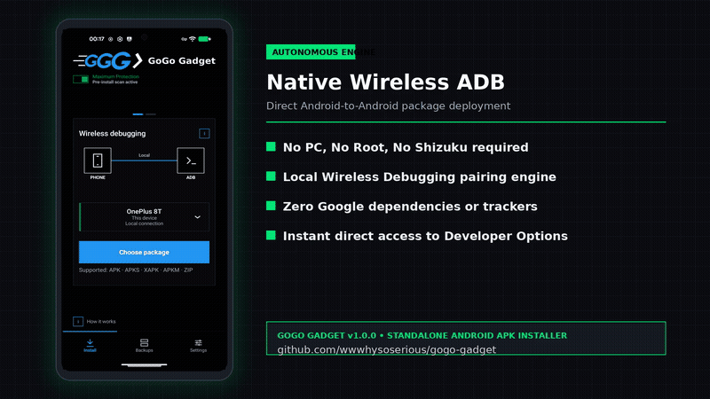
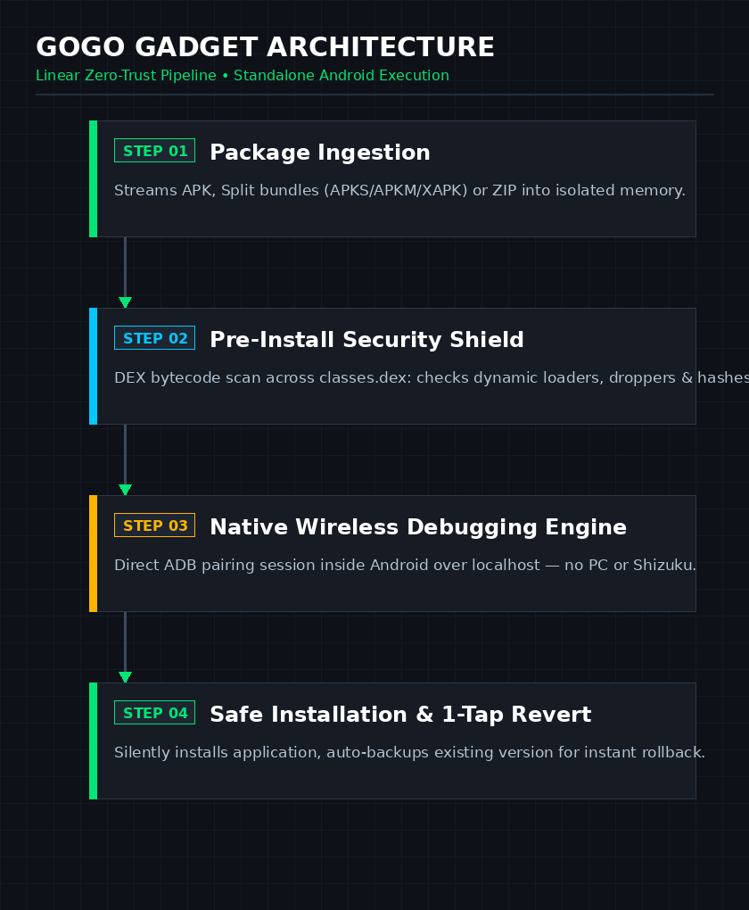

  

  
  
  

  
  
  
  
  
  

---

## Visión General

**GoGo Gadget** es el instalador y gestor de paquetes APK definitivo para Android, diseñado desde cero con **Seguridad Zero-Trust** y **Autonomía Total en tu propio móvil**.

A diferencia de las herramientas antiguas, se conecta directamente mediante la **Depuración inalámbrica** nativa de Android — es decir: **Sin Ordenador**, **Sin Root** y **Sin Procesos Ocultos en Segundo Plano** consumiendo batería.

### Puntos Fuertes Destacados:
* **Cero Permisos Peligrosos**: Privacidad al 100%. **Nunca pide acceso a tus fotos, documentos, archivos personales, contactos ni accesibilidad** (el permiso invasivo `MANAGE_EXTERNAL_STORAGE` nunca es necesario).
* **Soporte Completo de Split APKs**: Instala archivos `.apk` estándar, paquetes divididos (`.apks`, `.apkm`, `.xapk`) y archivos comprimidos `.zip` sin fallos ni errores raros de análisis.
* **Antivirus Previo a la Instalación**: Analiza el código DEX (`classes.dex`) antes de instalar para **detectar troyanos, droppers y permisos abusivos** antes de que el archivo toque el sistema.
* **Reversión Automática en 1 Toque**: ¿Has actualizado una app y la nueva versión viene con fallos o publicidad pesada? GoGo Gadget **guarda una copia de la versión anterior que funcionaba bien**, permitiéndote volver atrás con un solo toque y sin perder datos.
* **Envío a Otros Dispositivos de la Red**: Instala directamente en tu smartphone o **envía cualquier aplicación por Wi-Fi a otro móvil o tablet Android** de tu casa.
* **Cero Dependencias de Google**: **100% Código Abierto y Gratuito (GPL-3.0)**, sin servicios de Google Play, sin telemetría y sin rastreadores.
* **Solo Funciona Cuando lo Abres**: No deja procesos fantasma ejecutándose en segundo plano al cerrarlo.

---

## ¿Por qué GoGo Gadget? (La Diferencia)

| Característica | Instalador Normal | Instaladores con Shizuku | **GoGo Gadget** |
| :--- | :---: | :---: | :---: |
| **Requiere Conexión a PC** | Sí (para configurar) | Casi siempre | **Nunca** (100% en el móvil) |
| **Requiere Acceso Root** | No | Opcional / Modo Root | **No** (Cero Root) |
| **Servicio Permanente en 2º Plano** | No | Sí (Siempre corriendo) | **No** (Se apaga al salir) |
| **Inspección de Seguridad DEX** | Ninguna | Ninguna | **Análisis Completo de Código** |
| **Volver Atrás si la App Falla** | Ninguna | Ninguna | **Reversión en 1 Toque** |
| **Abre .xapk, .apkm, .apks** | Da Error | Requiere pasos manuales | **Instalación Directa** |
| **Envío a Androids en la Red** | No | No | **Detección Wi-Fi Integrada** |
| **Cero Código o Tracking Google** | No | Opcional | **100% Libre y Abierto** |

---

## Los Problemas Reales que GoGo Gadget Resuelve

* **El Problema de los Archivos Divididos (`.xapk`, `.apkm`, `.apks`)**
  * *El Dolor*: Descargas una actualización fuera de la tienda oficial y el móvil no puede abrir el archivo, mostrando un error de paquete no válido.
  * *La Solución*: GoGo Gadget descomprime en memoria y ejecuta la instalación correcta mediante ADB local al instante.

* **La Dependencia de Cables o Servicios Frágiles (como Shizuku)**
  * *El Dolor*: Tener que conectar el móvil al ordenador por USB o mantener un servicio en segundo plano que se detiene solo cada vez que reinicias el dispositivo.
  * *La Solución*: Se conecta directamente a la depuración inalámbrica local de Android sin depender de ordenadores.

* **El Riesgo de Instalar Apps a Ciegas (Troyanos Droppers)**
  * *El Dolor*: El sistema oficial solo comprueba firmas básicas y no te avisa si una app contiene código para descargar virus después de instalarla.
  * *La Solución*: El motor de seguridad analiza el código antes de instalar y te avisa inmediatamente si detecta comportamientos sospechosos.

* **Actualizaciones con Errores y Pérdida de Datos**
  * *El Dolor*: Una aplicación se actualiza, empieza a fallar y Android no te permite volver a la versión anterior sin borrar todos tus datos.
  * *La Solución*: GoGo Gadget guarda la versión anterior de forma automática para restaurarla con un toque.

* **La Pesadilla de los Permisos Invasivos**
  * *El Dolor*: Otros instaladores exigen acceso a todas tus fotos, documentos y archivos personales para poder funcionar.
  * *La Solución*: **Cero Permisos Peligrosos.** GoGo Gadget nunca toca tus fotos ni tus documentos personales.

* **Pasar Apps a Otro Dispositivo Android**
  * *El Dolor*: Tener que mandar archivos por memorias USB, WhatsApp o nubes lentas para instalar en otro dispositivo.
  * *La Solución*: Envía directamente por la red Wi-Fi de tu casa a cualquier otro dispositivo Android detectado.

---

## Demostración (Vídeo Promocional)

  
   
  <a href="https://github.com/wwwhysoserious/gogo-gadget/releases/download/v1.0.0/GoGo-Gadget-Phone-Promo.mp4">
    <b>⬇️ Descargar Vídeo en Alta Definición (Full HD 1080p MP4)</b>
  </a>

---

## Capturas de Pantalla

  
  &nbsp;&nbsp;
  
  &nbsp;&nbsp;
  

---

## Cómo Funciona

  

1. **Seleccionar el Archivo**: Abre archivos `.apk`, paquetes divididos (`.apks`, `.apkm`, `.xapk`) o archivos `.zip`.
2. **Inspección de Seguridad**: Análisis rápido de cabeceras DEX y comprobación de reputación para verificar que la aplicación es segura.
3. **Conexión Inalámbrica Segura**: Establece la sesión con el sistema por depuración inalámbrica directamente en tu móvil.
4. **Instalación y Copia de Seguridad**: Instala la aplicación y guarda una copia de la versión anterior para volver atrás cuando quieras.

---

## Descarga e Instalación

Descarga la versión oficial firmada desde la página de [Releases de GitHub](https://github.com/wwwhysoserious/gogo-gadget/releases/latest):

* **[Descargar GoGo Gadget v1.0.0 APK](https://github.com/wwwhysoserious/gogo-gadget/releases/download/v1.0.0/GoGo-Gadget-v1.0.0.apk)**

---

## Licencia

Distribuido bajo la licencia **GPL-3.0-or-later**. Consulta el archivo [LICENSE](LICENSE) para más detalles.
