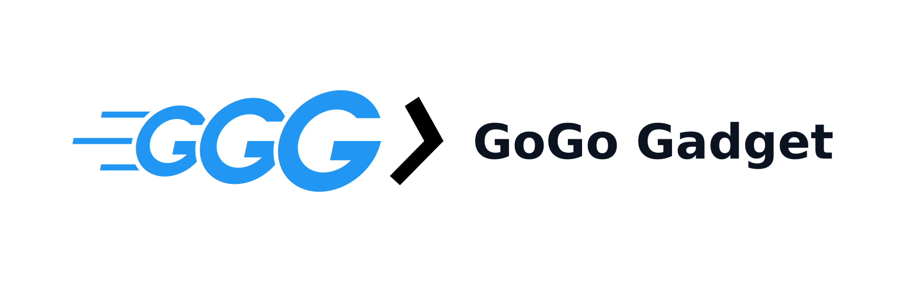
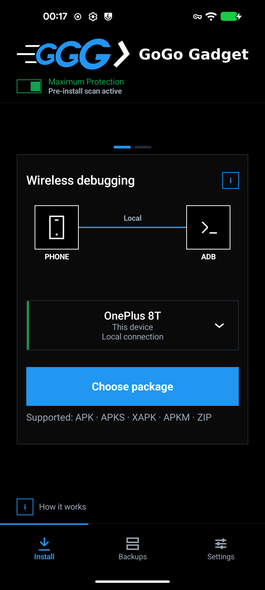
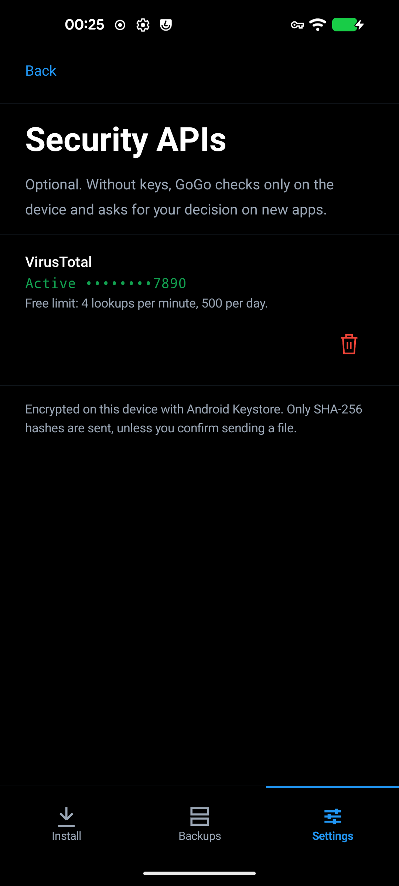

<p align="center">
  
</p>

<p align="center">
  <a href="https://github.com/wwwhysoserious/gogo-gadget/releases/latest"></a>
  <a href="LICENSE"></a>
  
  
  
  
</p>

---

## Overview

**GoGo Gadget** is a modern, standalone, zero-trust package manager and APK installer for Android. It operates independently on your device through Android's native **Wireless Debugging (ADB)** — eliminating the need for a PC, root privileges, or proprietary helper services.

Whether installing split packages (`.apks`, `.xapk`, `.apkm`), deploying to remote Android TVs across your local network, or reverting failed updates with 1-tap backups, GoGo Gadget delivers an uncompromising, privacy-respecting workflow with zero Google dependencies.

---

## Screenshots

<p align="center">
  
  &nbsp;&nbsp;
  
  &nbsp;&nbsp;
  
</p>

---

## How it Works

```
+-------------------+       +-----------------------+       +----------------------+
|   1. Pick File    | ----> | 2. Pre-Install Shield | ----> |  3. Local ADB Engine |
| APK / XAPK / Splits|       | Bytecode & Hash Scan  |       | Wireless Debugging   |
+-------------------+       +-----------------------+       +----------------------+
                                                                       |
                                                                       v
                                                            +----------------------+
                                                            | 4. Safe Install &    |
                                                            |    1-Tap Revert      |
                                                            +----------------------+
```

1. **Select Package**: Open standard APKs, split APK archives (`APKS`, `APKM`, `XAPK`), or `.zip` bundles. Extraction and validation execute directly in streaming memory without leaving temporary clutter.
2. **Multi-Tier Security Engine**:
   * **Local Bytecode Analyzer**: Inspects DEX bytecode header structures across `classes.dex`, detecting dynamic class loaders (`DexClassLoader`, `InMemoryDexClassLoader`), embedded binary droppers, abusive permission patterns, and obfuscated adware.
   * **Reputation Intelligence**: Cross-references package signatures with optional threat intelligence APIs.
   * **Strict Risk Tiers**: Clear color-coded verdicts: **Green** (verified clean), **Yellow** (caution / interactive override), and **Red** (known threat / signature collision block).
3. **Native Wireless Pairing**: Establishes local ADB sessions directly inside Android via pairing codes entered through a persistent notification or quick-access settings — no computer or external bridge required.
4. **Safety Rollbacks & Auto-Backup**:
   * When upgrading existing applications, previous APK versions are automatically preserved to application-private storage.
   * Revert any problematic update with a single tap from the **Backups** tab.
5. **Post-Install Cleanup**: Automatically removes source installation archives upon successful verification or keeps them according to user preference.

---

## Key Features

- **Zero-Trust Security**: Requests only essential permissions (`INTERNET`, `CHANGE_WIFI_MULTICAST_STATE`, `FOREGROUND_SERVICE`, `POST_NOTIFICATIONS`). Sandboxed isolation ensures your personal storage is never probed.
- **Split Package Native Engine**: Full parsing and installation for `.apk`, `.xapk`, `.apkm`, `.apks`, and compressed splits.
- **Target Flexibility**: Install locally on your handheld smartphone or push packages remotely to Android TVs and other network devices via mDNS.
- **1-Tap Rollback**: Automated previous-version archives safeguard against faulty app updates.
- **Industrial Clean Flat UI**: Precision high-contrast UI designed for rapid workflow and clarity.
- **100% Google-Independent**: No Google Play Services or Play Protect requirements.

---

## Download & Installation

Download the official signed release from the [GitHub Releases](https://github.com/wwwhysoserious/gogo-gadget/releases/latest) page:

* **[Download GoGo Gadget v1.0.0 APK](https://github.com/wwwhysoserious/gogo-gadget/releases/download/v1.0.0/GoGo-Gadget-v1.0.0.apk)**

---

## Building from Source

Requires **JDK 17** and the Android SDK:

```bash
export ANDROID_HOME=/path/to/android-sdk
./gradlew assembleRelease testDebugUnitTest
```

---

## Credits & Architecture

* ADB pairing and connection engine powered by [libadb-android](https://github.com/MuntashirAkon/libadb-android) (GPL-3.0-or-later / Apache-2.0), utilizing `spake2-java` (LGPL-3.0) and BouncyCastle cryptography.
* UI built with **Jetpack Compose** following an uncompromised dark industrial design spec.

---

## License

Distributed under the **GPL-3.0-or-later** license. See [LICENSE](LICENSE) for details.
